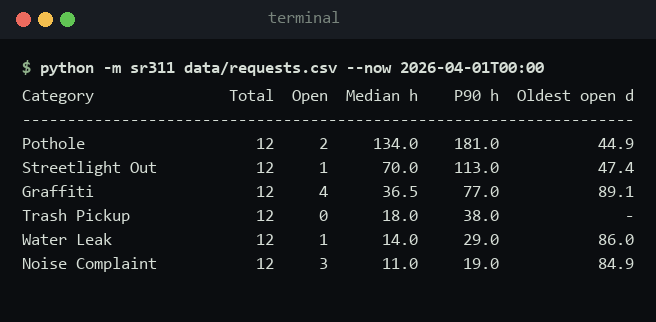

# 311-service-request-analyzer

Facility and city service teams need to know which request categories take longest to close and which open requests are getting old. This tool reads a service request CSV and prints, for each category, the count, open count, median and 90th percentile hours to close, and the age of the oldest open request.



## What it is for

A service desk gets hundreds of requests (potholes, leaks, noise, graffiti) and cannot tell by eye which kinds sit open the longest. Facility coordinators, building managers and city service supervisors use this tool to rank request categories by how slowly they close. They get one table showing where the backlog is and which open request is oldest, so they can assign staff and answer "how long does a leak repair really take".

## Install

```
git clone <repo-url> 311-service-request-analyzer
cd 311-service-request-analyzer
pip install -e .
```

Python 3.10 or newer. No dependencies.

## How to use

| I want to | Command |
|---|---|
| See time-to-close statistics for a CSV | `python -m sr311 data/requests.csv` |
| Age open requests against a fixed date so results repeat | `python -m sr311 data/requests.csv --now 2026-04-01T00:00` |
| Show help | `python -m sr311 --help` |

Without `--now`, open requests are aged against the current time.

Example:

```
$ python -m sr311 data/requests.csv --now 2026-04-01T00:00
Category               Total  Open  Median h    P90 h  Oldest open d
--------------------------------------------------------------------
Pothole                   12     2     134.0    181.0           44.9
Streetlight Out           12     1      70.0    113.0           47.4
Graffiti                  12     4      36.5     77.0           89.1
Trash Pickup              12     0      18.0     38.0              -
Water Leak                12     1      14.0     29.0           86.0
Noise Complaint           12     3      11.0     19.0           84.9
```

## How it works

- The CSV needs request_id, category, opened and closed (ISO date time). A blank closed value means the request is open.
- Hours to close is closed minus opened. A row closed before it opened is rejected with its line number.
- Median uses the standard library. The 90th percentile uses the nearest-rank method.
- Open requests are aged against `--now` so results are repeatable.
- Categories are sorted slowest median first; categories with nothing closed come last.

## Limits

Open requests are not counted in the median, so a category with many old open requests can look faster than it is. Check the Open and Oldest columns together. The sample data is synthetic.

Run the tests with `python -m pytest -q`.

## License

MIT. Copyright 2026 Yassine Emhamed.
